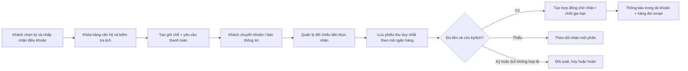

# Kiến trúc và dữ liệu NNland

## Nền được giữ lại

Giữ Maven WAR, tên lớp chạy `com.javaweb.SpringBootWebApplication`, cấu trúc `src/main/java`, `resources`, `webapp/WEB-INF/views`, cấu hình NetBeans và cách kết nối MySQL. Spring Boot được đồng bộ lên 2.7.18, mã nguồn vẫn nhắm Java 8; các phiên bản Tomcat/Security trước đó bị trộn được giao cho cơ chế quản lý dependency của Spring Boot.

Mô-đun hoạt động mới nằm trong `com.javaweb.nnland`. Các lớp gốc được giữ làm tham khảo, nhưng điểm chạy chỉ quét mô-đun mới. JPA/repository cũ không được khởi tạo; mô-đun NNland dùng repository JDBC với câu lệnh có tham số, transaction và khóa hàng rõ ràng. Các JSP cũ được giữ trong dự án gốc nhưng không phải giao diện đang hoạt động.

`WEB-INF/web.xml` cũ được lưu trong tài liệu tham khảo; cấu hình chạy mới tránh đăng ký lặp SiteMesh/Security khi dùng Tomcat nhúng hoặc WAR. Mô-đun mới dùng JSP include cho các phần chung.

## Các lớp mới

| Thư mục | Vai trò |
|---|---|
| config | Spring Security, Clock giờ Việt Nam, cấu hình tài nguyên và tác vụ định kỳ. |
| controller/web | Trang công khai, tài khoản, đặt thuê, thanh toán và tải tài liệu có kiểm tra sở hữu. |
| controller/admin | Giao diện quản lý và các thao tác được phân quyền. |
| model | Bản ghi tách khỏi connection và lỗi nghiệp vụ. |
| repository/Store | Truy vấn JDBC với tham số, sinh khóa, bản ghi kết quả. |
| service | Quy tắc đặt thuê/tiền/hóa đơn/hỗ trợ/hoàn/quyền/báo cáo. |
| utils | Kiểm tra dữ liệu, định dạng và tạo VietQR. |

CSS, JavaScript, ảnh, font và SVG trong `static/nnland`. JSP mới trong `WEB-INF/views/nnland`. Không cần ứng dụng React hay API công khai để giao diện hoạt động.

## Nhóm bảng

| Nhóm | Bảng |
|---|---|
| Tài khoản và phạm vi | nn_accounts, nn_building_staff, nn_reset_tokens |
| Danh mục tài sản | nn_buildings, nn_units, nn_favorites |
| Đơn và lưu trú | nn_bookings, nn_leases, nn_lease_requests |
| Tài chính | nn_payments, nn_receipts, nn_refunds, nn_bank_references, nn_invoices |
| Chăm sóc | nn_contacts, nn_tickets, nn_ticket_events |
| Vận hành | nn_notifications, nn_mail_outbox, nn_settings, nn_audit_log |

Tệp SQL trong `database/` và `src/main/resources/nnland-schema.sql` mô tả các cột, khóa ngoại, khóa duy nhất và chỉ mục. Cấu hình kết nối mặc định đi tới database `nnland`, không có lệnh xóa dữ liệu dự án cũ trong bước khởi động.

## Các trạng thái độc lập

| Đối tượng | Trạng thái chính |
|---|---|
| Căn hộ vật lý | READY, MAINTENANCE, INACTIVE; publication là thuộc tính riêng. |
| Đơn thuê/gia hạn | HOLD, PAYMENT_REVIEW, CONFIRMED, EXPIRED, CANCELLED. |
| Yêu cầu thanh toán | PENDING, PARTIAL, PAID, RECONCILE, EXPIRED, CANCELLED, REFUND_PENDING, REFUNDED. |
| Hợp đồng/lưu trú | RESERVED, ACTIVE, ENDING, CLOSED, CANCELLED. |
| Hóa đơn | UNPAID, PAID. |
| Khoản hoàn | PENDING, COMPLETED. |
| Hỗ trợ | OPEN, IN_PROGRESS, WAITING, RESOLVED, CLOSED. |
| Yêu cầu hủy/trả | OPEN, APPROVED, REJECTED. |

Khoảng thuê là `[start_date, end_date)`. Trạng thái READY không tự có nghĩa căn trống trong mọi ngày: lịch phải xét cùng các hợp đồng và giữ chỗ chưa hết hạn. Một hợp đồng ACTIVE đã quá hạn nhưng chưa trả vẫn chặn việc bàn giao căn cho khách khác.

## Đặt thuê và tiền

- Yêu cầu thanh toán có trước khi khách chuyển tiền.
- Mỗi phiếu thu lưu số tiền thực nhận, thời điểm, mã ngân hàng và người xác nhận.
- `nn_bank_references` dùng khóa duy nhất chung cho thu/hoàn, bảo vệ cả khi hai thao tác chạy đồng thời trên hai căn khác nhau.
- Căn hộ được khóa bằng `SELECT ... FOR UPDATE` trong các thay đổi lịch/tiền. Transaction dùng READ COMMITTED để kiểm tra lịch sau khi chờ khóa nhìn thấy thay đổi đã commit, tránh snapshot cũ của MySQL REPEATABLE READ.
- Việc ghi tiền, xác nhận đơn/hợp đồng, thông báo và hàng đợi email cùng commit hoặc cùng rollback.
- Việc gửi SMTP diễn ra sau qua outbox; không gọi SMTP trước khi commit giao dịch thuê.

## Snapshot và số tiền

Tiền lưu bằng số nguyên đồng; chỉ số/diện tích dùng DECIMAL, không dùng double để ghi tiền. Giá tháng, tiền cọc, phí và điều khoản được lưu trong đơn. Hợp đồng giữ thông tin nhận diện khách/căn và phí đã xác nhận.

Điện/nước tính bằng DECIMAL rồi làm tròn HALF_UP đến đồng. Chuỗi công tơ nối từ bàn giao tới các hóa đơn theo thứ tự. Chỉ hóa đơn mới nhất chưa có tiền thực nhận mới được sửa; việc sửa có lý do, audit và thông báo.

Báo cáo đọc trong transaction chỉ đọc với snapshot nhất quán. Phần dòng tiền lấy phiếu thu/hoàn; phần doanh thu phân bổ lấy kỳ thuê và các phí đã thanh toán. Tiền cọc, phần thừa và hóa đơn không bị cộng lặp.

## Quyền và dữ liệu

- Mật khẩu BCrypt; đăng ký công khai luôn tạo USER, không nhận vai trò do biểu mẫu tự gửi.
- CSRF cho các biểu mẫu thay đổi dữ liệu; đăng xuất qua POST.
- Trang/PDF/QR/phiếu thu kiểm tra chủ sở hữu hoặc quản lý đúng tòa.
- Quản lý không có quyền tự đổi vai trò, ngân hàng hoặc xem toàn bộ hàng đợi email/nhật ký.
- Các câu truy vấn nhận dữ liệu tìm kiếm qua tham số; cột sắp xếp lấy từ danh sách cố định.
- JSP thoát nội dung người nhập bằng JSTL; Excel ghi văn bản dưới dạng ô chuỗi thay vì công thức.
- Ảnh tải lên kiểm tra nội dung JPG/PNG, kích thước và số điểm ảnh, mã hóa lại với tên UUID; không dùng tên tệp khách cung cấp làm đường dẫn lưu.
- Token đặt lại mật khẩu ngẫu nhiên, chỉ lưu hash ở bảng token, hết hạn 30 phút và dùng một lần.
- Không xóa/sửa phiếu thu đã xác nhận qua giao diện; audit lưu các bước tài chính và thay đổi quyền.

## Tác vụ định kỳ

- Giải phóng giữ chỗ hết hạn, giữ lại lịch sử và khoản tiền đã nhận để đối soát.
- Gửi email đang chờ khi SMTP được bật; có retry giới hạn và trạng thái lỗi thực tế.
- Nhắc gần kết thúc và khi đến hạn hợp đồng; không tự trả phòng.

Bộ kiểm thử tắt tác vụ tự chạy để kiểm soát thời gian, nhưng gọi trực tiếp những quy tắc cần kiểm tra. Thư mục test và báo cáo kiểm thử đi kèm giúp bạn tiếp tục phát triển trên nền hiện tại.

## Hóa đơn cuối kỳ bổ sung

Hóa đơn cuối kỳ dùng `YYYY-MM-FINAL`. Nếu ngày bàn giao thay đổi sau khi đã thu tiền, phát hành `YYYY-MM-FINAL-001`, `-002`… nối tiếp chỉ số và ngày chốt của hóa đơn trước. Hóa đơn đã thu giữ nguyên; các hóa đơn phải cùng tháng với ngày chốt và tăng thứ tự. Phí dịch vụ/gửi xe đã tính trong tháng không tính lại. Chỉ quyết toán khi hóa đơn mới nhất đã thanh toán, là FINAL hoặc FINAL bổ sung và khớp ngày bàn giao cùng chỉ số thực tế.

Điều khoản được đọc cùng phiên bản trong một truy vấn; chữ ký báo giá bao gồm nội dung điều khoản. Khi tạo đơn, hệ thống lưu đúng bản vừa kiểm tra. Yêu cầu hủy đang mở chặn bàn giao. Tiền chuyển thêm vào hợp đồng đã đóng vẫn ghi phiếu thu, chuyển sang đối soát và hoàn phần thừa; không kích hoạt lại hợp đồng.
